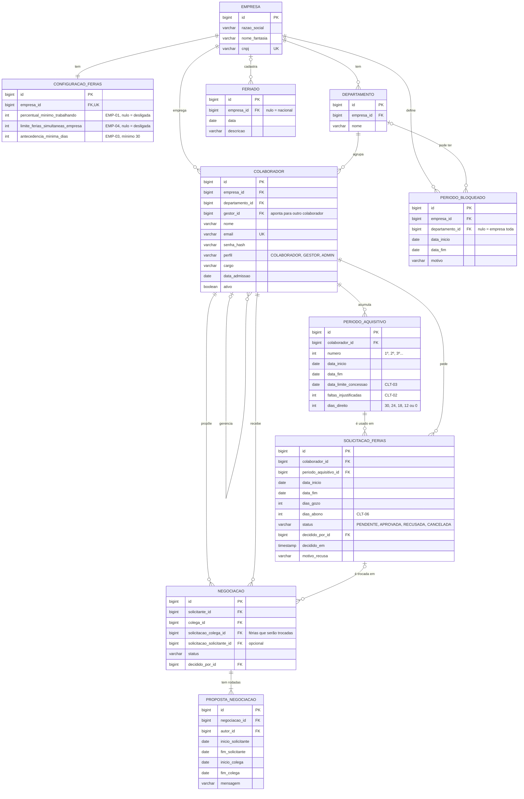

# Modelo de domínio do Crona

Este documento mostra **o que o Crona guarda** e **como os dados se ligam**. Ele vem antes do código porque tudo depende dele: as tabelas do banco, as classes Java e a API.

As regras citadas (`CLT-04`, `EMP-01`…) estão em [regras-de-negocio.md](regras-de-negocio.md).

## 1. Diagrama (DER)

O GitHub desenha o diagrama abaixo automaticamente. Ele foi escrito em [Mermaid](https://mermaid.js.org/), um formato de texto para diagramas.

Como ler as linhas: `||` = exatamente um, `o|` = zero ou um, `o{` = zero ou muitos, `|{` = um ou muitos.

Todas as tabelas também terão `criado_em` e `atualizado_em`. Eles ficaram fora do diagrama para não poluir.

## 2. As entidades

| Entidade | O que representa |
|---|---|
| **Empresa** | Cada cliente do Crona. Todos os outros dados pertencem a uma empresa. |
| **Configuração de férias** | As regras da empresa (EMP-01, 03 e 04). Uma por empresa. |
| **Departamento** | Setor da empresa. Usado no limite por setor (EMP-01). |
| **Colaborador** | Quem usa o sistema. Guarda os dados de trabalho e de login. |
| **Período aquisitivo** | Cada 12 meses trabalhados, com o direito de dias que ele gerou. |
| **Solicitação de férias** | Um pedido de férias, inteiro ou uma parte delas. |
| **Negociação** | Uma troca de período entre dois colaboradores. |
| **Proposta de negociação** | Cada rodada da negociação: a proposta inicial e as contrapropostas. |
| **Período bloqueado** | Datas em que não se pode sair de férias (EMP-05). |
| **Feriado** | Usado para impedir o início das férias perto de um feriado (CLT-05). |

## 3. Decisões e por quê

Cada decisão abaixo tinha mais de um caminho. Saber explicar a escolha é o que conta numa entrevista.

### 3.1 Várias empresas no mesmo banco (multi-tenant)
Como o Crona pode ser vendido para várias empresas, quase toda tabela se liga a uma `empresa`. Todas as empresas ficam no mesmo banco, e cada consulta filtra pela empresa de quem está logado.

- **Alternativa:** um banco separado para cada empresa. Isola mais, mas é bem mais difícil de manter.
- **Cuidado:** esquecer o filtro por empresa numa consulta vaza dados de um cliente para outro. Vamos tratar isso na Fase 3, junto com a segurança.

### 3.2 Regras da empresa em colunas, não em uma lista genérica
Cada regra configurável é uma coluna em `configuracao_ferias`. **Valor nulo = regra desligada.**

- **Alternativa:** uma tabela genérica do tipo `chave = valor`. É flexível, mas o banco não consegue validar tipos nem limites.
- **Escolha:** colunas. Adicionar uma regra nova vira uma migração do Flyway, o que é fácil e deixa histórico.

### 3.3 Colaborador e login na mesma tabela
O colaborador já guarda `email`, `senha_hash` e `perfil`. Uma tabela `usuario` separada só faria sentido se existisse quem entra no sistema sem ser colaborador. Se isso aparecer depois, separamos.

- A senha **nunca** é guardada como texto. Guardamos só o *hash* (BCrypt), uma "impressão digital" que não dá para reverter.

### 3.4 Gestor é um colaborador
`gestor_id` aponta para outra linha da própria tabela `colaborador`. Isso se chama **auto-relacionamento**. Assim o gestor também tem férias, saldo e solicitações, como no protótipo.

### 3.5 Período aquisitivo é guardado, mas o saldo é calculado
No protótipo os períodos eram recalculados a cada tela. Aqui eles ficam salvos, porque cada um tem dados próprios que precisam de histórico: faltas (CLT-02) e prazo de concessão (CLT-03).

Já o **saldo não fica salvo**. Ele é calculado: `dias_direito` menos a soma dos dias das solicitações `PENDENTE` e `APROVADA` daquele período. Guardar o saldo seria dado duplicado, e dado duplicado acaba ficando diferente do original.

### 3.6 Solicitação aponta para o período aquisitivo
Cada pedido "gasta" dias de um período específico. É isso que permite validar a divisão em até 3 partes (CLT-04) e o abono (CLT-06) por período.

### 3.7 Negociação com rodadas
O protótipo guardava a contraproposta em campos extras, então só cabia uma contraproposta. Aqui cada rodada é uma linha em `proposta_negociacao`, e **a proposta vigente é a mais recente**. Isso permite ir e voltar quantas vezes for preciso e guarda o histórico da conversa.

A negociação também aponta para **as solicitações exatas** que estão sendo trocadas. Isso corrige um erro do protótipo, que alterava a primeira solicitação que encontrava do colaborador.

Quando o gestor aprova, as solicitações antigas viram `CANCELADA` e são criadas novas com as datas combinadas. Nada é apagado, então dá para ver o que aconteceu.

Status da negociação: `AGUARDANDO_COLEGA`, `AGUARDANDO_SOLICITANTE` (quando há contraproposta), `AGUARDANDO_GESTOR`, `APROVADA`, `RECUSADA`, `CANCELADA`.

### 3.8 Enums como texto
Campos como `status` e `perfil` são guardados como texto (`'PENDENTE'`), não como número (`0`, `1`). Fica legível no banco, e reordenar o enum no Java não estraga os dados. O banco também confere os valores aceitos com uma restrição `CHECK`.

### 3.9 Chave primária numérica
Os `id` são `BIGINT` gerados pelo banco. É simples, rápido e combina bem com JPA.

- **Alternativa:** UUID. É útil para não expor na URL quantos registros existem (`/colaboradores/42`). Podemos usar UUID só nas URLs mais tarde, se for preciso.

### 3.10 Nomes em português
Tabelas e colunas usam os termos da CLT (`periodo_aquisitivo`, `abono`), porque traduzir esses termos para o inglês mais confunde do que ajuda. Padrão: `snake_case` no banco e `camelCase` no Java.

## 4. O que ficou de fora (por enquanto)

- **Limite financeiro em R$ (EMP-04):** precisaria do salário de cada colaborador, que é um dado sensível. Por enquanto o limite é por **número de pessoas**. Depende da dúvida em aberto no documento de regras.
- **Notificações e anexos:** entram na Fase 8.
- **Escala de folga por colaborador:** por enquanto, para a CLT-05, o descanso semanal considerado é sábado e domingo.
